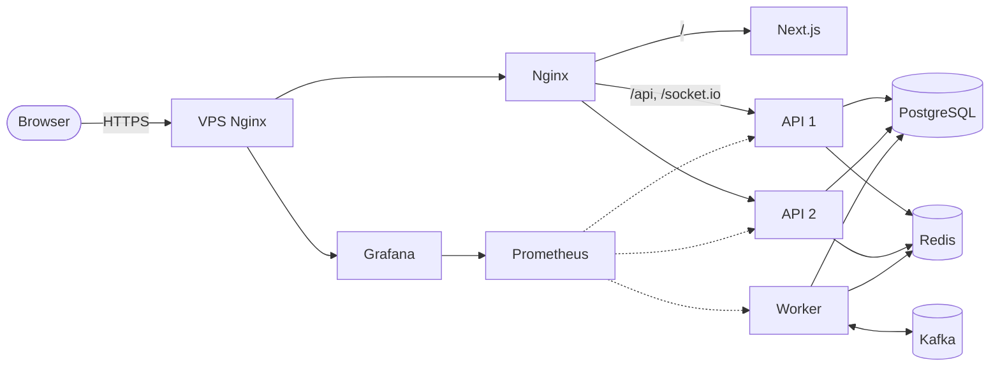

# Questa Booking

**English** | [Tiếng Việt](README.vi.md) &nbsp; [](https://github.com/mquanggdev/questa-booking/actions/workflows/ci.yml)

A concert ticketing backend that holds up when thousands of people try to buy the same seats at once: no seat sold twice, no payment lost, and load tests to back it up.

**Live demo:** <https://booking.quangtm.site> · [Swagger](https://booking.quangtm.site/api/docs) · [Grafana](https://grafana.quangtm.site) (read-only)

- Register any account to buy tickets. Pay with the built-in fake gateway, or with VNPay's sandbox using its [test cards](https://sandbox.vnpayment.vn/apis/vnpay-demo/). No real money either way.
- Organizer view: `demo@questa.test` / `demo-f175ef55`. Read-only: every write returns `403`.


## Why it is hard

An on-sale is a few minutes of heavy traffic where everyone wants the same seats. The obvious code (read the seat, see it is free, write the order) sells one seat to two people as soon as requests overlap. I started from that version, measured how often it breaks, then fixed it piece by piece and measured again.

## Architecture



- **PostgreSQL** is the only source of truth. Every sale is decided there.
- **Redis** sits in front as a fast filter, holds reservations with a TTL, backs the waiting room, rate limits, cache and the Socket.IO adapter. If Redis goes down, the database still keeps things correct.
- **Worker** runs BullMQ jobs (expire holds, refunds, admit people from the waiting room) and relays events from an outbox table to Kafka.
- **Kafka** carries order events to three consumers: ticket emails, sales stats, audit log.

Stack: NestJS · PostgreSQL · Prisma · Redis · BullMQ · Kafka · Socket.IO · Next.js · k6 · Docker Compose · GitHub Actions · Prometheus · Grafana.

## Key decisions

Full reasoning, with the alternatives I rejected, is in [`docs/adr/`](docs/adr/) (Vietnamese).

- **Locking in the database.** A seat is held with a single conditional `UPDATE ... WHERE status = 'AVAILABLE'`; standing zones use a counter guarded the same way; unique indexes catch anything left. `SERIALIZABLE` was correct too, but retried too much under contention. ([0008](docs/adr/0008-seat-and-standing-locking.md))
- **Idempotency keys stored with the order**, in the same transaction, so a double click or a retry returns the same order. ([0009](docs/adr/0009-idempotency-and-ticket-limit.md))
- **Redis filters, it does not decide.** It turns away most losing requests before they reach the database. When Redis fails, requests go straight to PostgreSQL instead of being refused. ([0010](docs/adr/0010-redis-gate-and-expiry.md))
- **Shed load with `503 Retry-After`** instead of letting requests queue until they time out. ([0007](docs/adr/0007-load-testing-and-overload.md))
- **Payments are confirmed only by the signed IPN** from the gateway, never by the redirect. Money that arrives for an expired order is refunded automatically. ([0012](docs/adr/0012-payments-ipn-and-refunds.md))
- **Transactional outbox for events.** The event is written in the same transaction as the order change; a relay publishes it to Kafka; consumers deduplicate in the same transaction as their own write. Publishing straight to Kafka after commit can lose events. ([0017](docs/adr/0017-outbox-kafka-and-consumers.md))
- **Waiting room in a Redis sorted set**, with a Lua script handing out ticket numbers and a BullMQ job letting people in at a rate measured on this machine. ([0016](docs/adr/0016-presale-codes-and-waiting-room.md))

BullMQ handles work that needs scheduling or retries (expiring holds, refunds, admitting from the queue). Kafka handles facts other parts of the system react to (order paid, expired, refunded).

## Benchmarks

k6 runs inside the Docker network, then SQL checks the results directly in PostgreSQL. Laptop: Ryzen 5 4600H, 16 GB. Full history: [`docs/benchmarks.md`](docs/benchmarks.md).

| Scenario | Before | After |
| --- | --- | --- |
| 5,000 buyers, 100 seats | naive code: **4–11 seats sold twice** per run | database locking: **0** in every run |
| 5,000 buyers, 500 standing tickets | **925 tickets** issued for 500 places | exactly **500** |
| Same seat contention, Redis filter off → on | 159–211 req/s, p50 ~5 s | **701–815 req/s**, p50 11–456 ms |
| 1 → 2 API instances | 525 req/s | **790 req/s**; killing one mid-run breaks nothing |
| Catalog reads at 400 req/s, cache off → on | p95 4.9 s | p95 **7 ms** |
| On-sale: 4,000 buyers, 10,000 tickets | no waiting room: p95 **10.7 s**, 16% errors | waiting room: p95 **99–272 ms**, 0 errors, 0 people skipped the line |
| Payment chaos: duplicate, forged and late IPNs | — | **0** double charges or lost payments; 500 paid, 250 refunded |
| Order events through Kafka, worker killed mid-run | — | every event applied **exactly once** by all 3 consumers |

Numbers on this laptop can vary a few times between runs, so before/after comparisons are always run back to back.


## Run it

Requires Docker, Node.js 24 and pnpm.

```bash
cp .env.example .env
docker compose up -d --build
pnpm install
pnpm --filter @questa/api db:seed
```

- Web: <http://localhost:3200>
- Swagger: <http://localhost:3000/api/docs>
- Mailpit (ticket emails): <http://localhost:8025>
- Grafana: `docker compose --profile monitoring up -d`, then <http://localhost:3300>

Seed accounts use the password in `SEED_PASSWORD`: `organizer@questa.test`, `customer0001@questa.test` … `customer5000@questa.test`. To pay on the real VNPay sandbox, see [`docs/vnpay-sandbox.md`](docs/vnpay-sandbox.md).

```bash
pnpm test                 # unit tests
pnpm test:e2e             # end-to-end tests (needs the stack running)
pnpm loadtest contention  # or: standing, browse, full-flow, webhook-chaos, check-in, on-sale
```

Deploys run from GitHub Actions on a version tag: build images, push to GHCR, SSH to the VPS, start the new version and roll back if it is not healthy. Server setup: [`docs/deploy-vps.md`](docs/deploy-vps.md).

## Limitations

- Everything runs on one VPS with a single PostgreSQL, Redis and Kafka node. Good enough for a demo, not for real availability.
- The ticket email consumer is the slowest part at peak (about 28 s behind at p95), because it renders QR codes and sends mail one event at a time.
- Payments run on the fake gateway or VNPay's sandbox, never in production. Emails stay in Mailpit on the server and are never delivered.
- No admin UI: organizers create concerts and sale phases through the API.

## License

[MIT](LICENSE)
