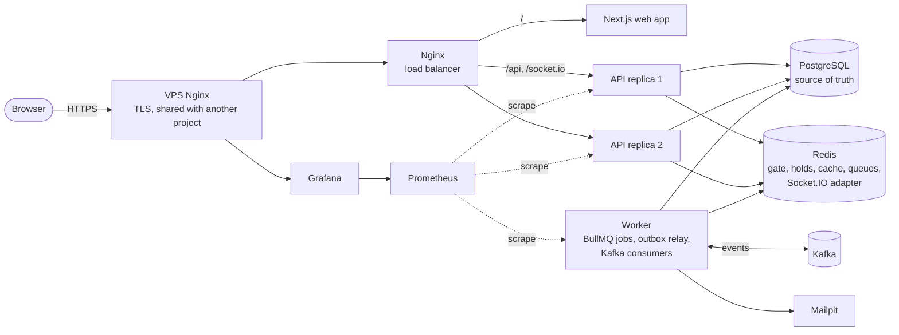

# Questa Booking

**English** | [Tiếng Việt](README.vi.md) &nbsp; [](https://github.com/mquanggdev/questa-booking/actions/workflows/ci.yml)

A concert ticketing backend built to sell exactly the seats that exist when thousands of people buy at the same moment, and to prove it with numbers.

> **Status:** all phases of the plan are done, and the full stack runs online. Phase 9 added Prometheus metrics, a Grafana dashboard, slim images built by CI, and a deploy over SSH that goes back to the previous version when the new one is not healthy.

**Live demo:** <https://booking.quangtm.site> · API docs (Swagger): <https://booking.quangtm.site/api/docs> · Grafana (read-only): <https://grafana.quangtm.site>

- Buy tickets: register any account (the email does not have to exist). Payments go through a fake gateway, so no money moves.
- Organizer view: sign in as `demo@questa.test` / `demo-f175ef55`. This account can open every organizer page, including the live sales dashboard of each performance, but cannot change anything (`403 DEMO_READ_ONLY`).
- Ticket emails are kept by Mailpit on the server and never delivered, so the addresses of people trying the demo stay private.


## The problem

Ticket on-sales are short, violent bursts of traffic where many buyers want the same few seats. A naive "read the seat, see it is free, then write" sells one seat to two people under load. This project starts from exactly that broken version, measures the double-sells, and then removes them step by step: database locking, time-limited holds in Redis, idempotent payments, multiple instances, a virtual waiting room, and event streaming with Kafka. Every step is benchmarked.

## Architecture

Two API replicas sit behind Nginx; PostgreSQL decides every sale, Redis only filters and speeds up. The worker runs background jobs (BullMQ) and moves business events from the outbox table to Kafka and on to three consumers. Online, the whole stack runs on one small VPS next to another project, behind that project's Nginx ([ADR-0014](docs/adr/0014-defer-online-deploy.md), [ADR-0018](docs/adr/0018-monitoring-and-deploy.md)).



## Key decisions

Each one has an ADR with the context, the options that were rejected and why (Vietnamese).

| Decision | Rejected | ADR |
| --- | --- | --- |
| Double-selling is stopped **in PostgreSQL**: a conditional `UPDATE` per seat, a guarded counter per standing zone, unique indexes as the last line | `SERIALIZABLE` (constant retries under contention), locks in the application or in Redis (wrong with several replicas, or when Redis loses data) | [0008](docs/adr/0008-seat-and-standing-locking.md) |
| A mandatory `Idempotency-Key`, and the per-account ticket limit checked inside the same transaction | Keys in Redis (not the source of truth, not in the order's transaction), a lock on the user row | [0009](docs/adr/0009-idempotency-and-ticket-limit.md) |
| A Redis gate in front of the database; holds expire through BullMQ; **fail open** when Redis is down | Redis as the source of truth, failing closed (one Redis incident would stop all sales), TTL alone (the database would still say `HELD`) | [0010](docs/adr/0010-redis-gate-and-expiry.md) |
| Overload answers `503` with `Retry-After` | Raising pool size and timeouts until errors disappear (latency explodes instead) | [0007](docs/adr/0007-load-testing-and-overload.md) |
| Payments are confirmed only by the signed IPN; money arriving for a closed order is always refunded | Trusting the return URL, answering the IPN first and processing later | [0012](docs/adr/0012-payments-ipn-and-refunds.md) |
| Realtime seat map: a snapshot plus ordered changes (`seq`) read back from the database after commit | Pushing straight from the transaction (clients could see a rolled-back state), sticky sessions | [0015](docs/adr/0015-scale-out-realtime-cache-rate-limit.md) |
| Virtual waiting room: a Lua-assigned ticket number in a Redis sorted set, admitted in batches by a BullMQ job at a measured rate | Arrival time as the score (ties are ordered by user id), one position message per person | [0016](docs/adr/0016-presale-codes-and-waiting-room.md) |
| Events go through a **transactional outbox**; consumers deduplicate in the same transaction as their effect | Publishing to Kafka after commit (a dual write), Kafka transactions, Debezium, deduplication in Redis | [0017](docs/adr/0017-outbox-kafka-and-consumers.md) |
| Images built by CI and pulled by the VPS; a deploy script that rolls back to the previous tag | Building on the VPS, Watchtower (no health check, no rollback) | [0018](docs/adr/0018-monitoring-and-deploy.md) |

### BullMQ and Kafka

They do different jobs and are never used for each other's.

| Work | Tool | Why |
| --- | --- | --- |
| Release a hold when it expires | BullMQ | A delayed job |
| Refund a payment | BullMQ | Retries with backoff, then a dead letter queue |
| Admit people from the waiting room | BullMQ | A repeating, rate-limited job |
| Tell others an order was paid, expired or refunded | Kafka | One event, several independent consumers (emails, sales statistics, audit) |

## Stack

NestJS 12 (TypeScript, ESM) · PostgreSQL 18 · Prisma 7 · Redis 8 · BullMQ · Kafka · Socket.IO · Next.js · k6 · Docker Compose · GitHub Actions · Prometheus and Grafana

Why each one is here: [`docs/adr/`](docs/adr/).

## Run it

Requirements: Docker, Node.js 24, pnpm.

```bash
cp .env.example .env
docker compose up -d --build
curl localhost:3000/api/v1/health/ready
```

`docker compose up` starts PostgreSQL, Redis, Kafka and Mailpit, applies migrations, then starts two API replicas, the background worker and the web app, all behind Nginx, the single entry point (`/` to the web app, `/api` and `/socket.io` to the API replicas).

- Web app: <http://localhost:3200>. Pick a performance, select seats on the map, hold them, pay at the fake gateway, get QR tickets. Seats held or sold by other buyers change color live. Every response names the replica that served it in an `X-Instance` header.
- After seeding: "Questa Arena Live" (10,000 tickets) sells through the virtual waiting room, and "Questa Fan Club Night" is in its presale; its 50 presale codes are written to `load-tests/data/fixtures.json`.

Payments use the local fake gateway by default (`PAYMENT_PROVIDER=fake`), so no account is needed. To pay on the real VNPay sandbox, follow [`docs/vnpay-sandbox.md`](docs/vnpay-sandbox.md) (Vietnamese).

- Organizers follow a sale live at `/performances/<id>/sales` (sign in as `organizer@questa.test`).
- Emails (ticket QR codes, cancellations, refunds) go to Mailpit, a local inbox: <http://localhost:8025>.
- API docs (Swagger): <http://localhost:3000/api/docs>
- Load sample data (wipes the development database):

  ```bash
  pnpm install
  pnpm --filter @questa/api db:seed
  ```

  Accounts: `organizer@questa.test`, `staff@questa.test`, `customer0001@questa.test` … `customer5000@questa.test`, all with the password in `SEED_PASSWORD` (`.env.example`).

### Develop on the host

```bash
pnpm install
docker compose up -d postgres redis
pnpm --filter @questa/api start:dev
pnpm --filter @questa/web dev        # http://localhost:3200
```

| Command | What it does |
| --- | --- |
| `pnpm lint` / `pnpm typecheck` / `pnpm format:check` | Static checks |
| `pnpm test` | Unit tests |
| `pnpm test:e2e` | End-to-end tests on a separate `questa_test` database and their own Kafka topics (needs PostgreSQL, Redis, Kafka and Mailpit) |
| `pnpm test:browser` | Playwright tests of the buying flow in a real browser (needs the stack running and seeded, with `RATE_LIMIT_ENABLED=false`) |

## Benchmarks

Every number comes from `pnpm loadtest <scenario>`: k6 inside the compose network, then SQL checks straight against PostgreSQL. Full table: [`docs/benchmarks.md`](docs/benchmarks.md).

| Phase | Scenario | Result |
| --- | --- | --- |
| 2: naive "read, check, write" | 5,000 buyers, 100 seats | **4–11 seats sold twice** in every run |
| 2: naive | 5,000 buyers, 500 standing tickets | **925 tickets issued** for 500 places; the counter recorded 94 (831 lost updates) |
| 2: naive | catalog reads, one API process | 100 req/s at p95 41 ms; saturates (CPU-bound) before 200 req/s |
| **3: database guards** | 5,000 buyers, 100 seats | **0 seats sold twice in 5 runs in a row**, exactly 100 tickets |
| 3 | 5,000 buyers, 500 standing tickets | exactly **500** tickets, counter matches |
| 3 | 20 accounts × 50 parallel requests, limit 6 | exactly **6 per account** (120 total) |
| 3 | 3 seat-locking strategies compared | all correct, within ~10% of each other (re-measured, see below) ([ADR-0008](docs/adr/0008-seat-and-standing-locking.md)) |
| **4: Redis gate off → on** | 5,000 buyers, 100 seats | 159–211 → **701–815 req/s**, p50 ~5 s → **11–456 ms**, 503s → **0**; still 0 double-sells |
| 4 | 5,000 buyers, 500 standing tickets | ~200 → **~510 req/s**, p50 ~4.5 s → **~25 ms** |
| **5: payments** | webhook chaos: every IPN 5× in parallel, wrong amounts, forged signatures, money after the order was cancelled, cancel racing the IPN | **0 violations** of I2/I4/I8/I9/I12; 500 payments confirmed exactly once, 250 refunded |
| 5 | 5,000 buyers: hold → pay → get tickets | all 500 held tickets paid and issued, 0 violations; ~6% of holds shed with 503 under load |
| 5 | 5,000 concurrent scans of 100 tickets | exactly **100 accepted**; 267 → **365 req/s** after making an accepted scan one statement |
| **7a: 1 → 2 API replicas behind Nginx** | 5,000 buyers, 100 seats | 525 → **790 req/s**, p95 7.3 s → 4.8 s; still 0 double-sells |
| 7a | 5,000 buyers, 500 standing tickets | 436 → **614 req/s**; exactly 500 tickets |
| 7a | one replica killed (`docker kill`) 5 s into the run | **0 invariant violations** in both scenarios; only the requests in flight on the dead replica fail |
| 7a: catalog cache off → on | 400 req/s of catalog reads | could only sustain 362 req/s at p95 4.9 s → **400 req/s at p95 7 ms** |
| **7b: on-sale, 10,000 tickets** | 4,000 buyers queue before the opening; 5% try to skip the line | waiting room admitting **50/s**: holds p50 **20 ms**, p95 **99 ms**, 0 errors, **0 of 114** line-skippers got through |
| 7b | same rush, admitting 100/s | over capacity on this machine: holds p50 3.7 s, 503s (the pool is exhausted). The admission rate is set from measurements |
| 7b | same rush, **no waiting room** | holds p95 **10.7 s**, 16% of requests fail with 503; still 0 invariant violations |
| 7b | first on-sale run, before fixing the stack | 28,457 × 502: Node's listen queue overflowed and a keep-alive race made Nginx mark both healthy replicas dead ([ADR-0016](docs/adr/0016-presale-codes-and-waiting-room.md)) |
| **8: outbox + Kafka** | 5,000 buyers: hold → pay → tickets, then wait for the events | 500 `order.paid` events, each applied **exactly once** by all 3 consumers (**0 I7 violations**), audit and sales counters match; same throughput as phase 5 |
| 8 | the worker (relay + consumers) killed 8 s into the run | after it restarts, every event is still applied exactly once: **0 violations** |
| **9: Prometheus metrics on** | same on-sale rush (10,000 tickets, waiting room at 50/s) | 586 req/s, holds p50 **23 ms**, p95 **272 ms**, 0 errors, 0 violations. Interleaved with the phase 7b code on the same day: p95 2,079 / 263 / 1,629 ms (7b) vs 731 / 291 / 596 ms (now), so no slowdown; the spread between runs comes from the laptop |

> A measurement bug (`docker compose run` silently recreated the API with default settings) invalidated three earlier comparisons. The load-test script now records the API's real configuration with every result; affected rows are marked and re-measured ([ADR-0011](docs/adr/0011-benchmark-config-integrity.md)).

```bash
pnpm --filter @questa/api db:seed
pnpm loadtest contention      # or: standing, quota, browse, full-flow, webhook-chaos, check-in, on-sale
```

## Monitoring

Each API replica exposes `/api/v1/metrics` and the worker its own metrics port; Prometheus scrapes them inside the Docker network, and the public Nginx answers `404` on that path. The Grafana dashboard shows request rate and latency by route, outbox backlog, consumer lag, BullMQ queues and the waiting room.


During the on-sale load test above, the dashboard showed what the totals did not: the `notifications` consumer (SMTP and QR images) fell behind the event rate, about 28 s at p95, while `analytics` and `audit` kept up almost immediately.

Locally: `docker compose --profile monitoring up -d`, then Grafana at <http://localhost:3300>.

## Deploy

Pushing a `v*` tag (or running the **Deploy** workflow by hand) builds three images (API, migrations, web), pushes them to GitHub Container Registry, copies the compose file to the VPS over SSH with a pinned host key, and runs [`deploy/deploy.sh`](deploy/deploy.sh): pull, migrate, start, wait until the API answers through the stack's Nginx, and go back to the previous tag if it does not. One-time server setup: [`docs/deploy-vps.md`](docs/deploy-vps.md) (Vietnamese).

## Known limits and next steps

- **One machine, one node of everything.** PostgreSQL, Redis and Kafka have no replicas online; the demo shows behavior, not availability. Every benchmark was measured locally on a laptop, not on the VPS, and the same run can vary several times over on it (free memory, Docker Desktop's state), so before/after comparisons are run interleaved on the same day.
- **The ticket email consumer is the slowest part** at peak (above). Next: more partitions and consumer concurrency, and QR images generated once per ticket instead of per email.
- **Payments online use the fake gateway.** The VNPay sandbox flow is implemented and documented, but has not been verified end to end with a working sandbox merchant.
- **No admin interface.** Organizers create concerts and sale phases through the API (Swagger); the web app only has the sales dashboard for them.
- **Migrations are never rolled back.** A rollback of the code keeps the new schema, so every migration has to work with the previous version of the code (expand first, contract later).
- **Next steps:** tracing across API, worker and Kafka (OpenTelemetry), a real email provider, and load tests run from a separate machine against the online stack.

## Documentation

- [Specification](docs/spec.md) (Vietnamese)
- [Architecture decision records](docs/adr/) (Vietnamese)
- [Paying on the VNPay sandbox](docs/vnpay-sandbox.md) (Vietnamese)
- [Deploying to the VPS](docs/deploy-vps.md) (Vietnamese)

## License

[MIT](LICENSE)
