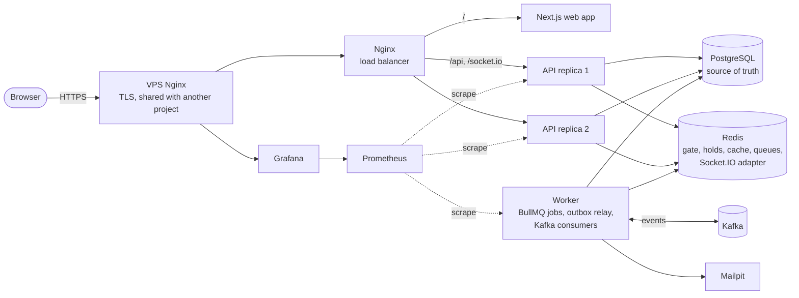

# Questa Booking

[English](README.md) | **Tiếng Việt** &nbsp; [](https://github.com/mquanggdev/questa-booking/actions/workflows/ci.yml)

Backend bán vé concert, được xây để bán đúng số ghế đang có khi hàng nghìn người cùng mua một lúc, và chứng minh điều đó bằng số liệu.

> **Trạng thái:** đã xong mọi giai đoạn trong kế hoạch, và toàn bộ stack đang chạy online. Giai đoạn 9 thêm metrics Prometheus, dashboard Grafana, image gọn do CI build, và quy trình deploy qua SSH tự quay về bản trước nếu bản mới không khỏe.

**Bản demo online:** <https://booking.quangtm.site> · Tài liệu API (Swagger): <https://booking.quangtm.site/api/docs> · Grafana (chỉ xem): <https://grafana.quangtm.site>

- Mua vé: đăng ký một tài khoản bất kỳ (email không cần có thật). Thanh toán đi qua cổng giả lập, không có tiền thật.
- Góc nhìn ban tổ chức: đăng nhập bằng `demo@questa.test` / `demo-f175ef55`. Tài khoản này mở được mọi trang của ban tổ chức, gồm trang theo dõi mở bán trực tiếp của từng đêm diễn, nhưng không thay đổi được gì (`403 DEMO_READ_ONLY`).
- Email vé được Mailpit giữ lại trên server, không gửi đi thật, để địa chỉ email của người dùng thử không bị lộ.


## Bài toán

Đợt mở bán vé là những đợt truy cập ngắn và dồn dập, khi rất nhiều người cùng muốn vài ghế giống nhau. Cách làm ngây thơ "đọc ghế, thấy trống, rồi ghi" sẽ bán một ghế cho hai người khi tải cao.

Dự án bắt đầu từ đúng phiên bản lỗi đó, đo số ghế bị bán trùng, rồi loại bỏ lỗi từng bước: khóa ở database, giữ vé có thời hạn bằng Redis, thanh toán idempotent, chạy nhiều instance, hàng chờ ảo, và phát sự kiện qua Kafka. Mỗi bước đều có benchmark.

## Kiến trúc

Hai instance API đứng sau Nginx; PostgreSQL quyết định mọi lượt bán, Redis chỉ lọc bớt và tăng tốc. Worker chạy việc nền (BullMQ) và chuyển sự kiện nghiệp vụ từ bảng outbox sang Kafka, tới ba consumer. Bản online chạy toàn bộ stack trên một VPS nhỏ, cạnh một dự án khác, sau Nginx của dự án đó ([ADR-0014](docs/adr/0014-defer-online-deploy.md), [ADR-0018](docs/adr/0018-monitoring-and-deploy.md)).



## Các quyết định chính

Mỗi quyết định có một ADR ghi bối cảnh, các phương án đã loại và lý do.

| Quyết định | Phương án đã loại | ADR |
| --- | --- | --- |
| Chống bán trùng **ngay trong PostgreSQL**: `UPDATE` có điều kiện cho từng ghế, bộ đếm có điều kiện cho khu đứng, unique index là lớp chặn cuối | `SERIALIZABLE` (phải thử lại liên tục khi tranh chấp cao), khóa ở ứng dụng hoặc ở Redis (sai khi có nhiều instance, hoặc khi Redis mất dữ liệu) | [0008](docs/adr/0008-seat-and-standing-locking.md) |
| Bắt buộc `Idempotency-Key`, và giới hạn vé mỗi tài khoản được kiểm tra trong cùng transaction | Lưu key trong Redis (không phải nguồn sự thật, không cùng transaction với đơn), khóa dòng người dùng | [0009](docs/adr/0009-idempotency-and-ticket-limit.md) |
| Bộ lọc Redis trước database; vé giữ hết hạn qua BullMQ; **cho qua (fail open)** khi Redis lỗi | Redis làm nguồn sự thật, từ chối hết khi Redis lỗi (một sự cố Redis làm ngừng toàn bộ việc bán), chỉ dùng TTL (database vẫn ghi `HELD`) | [0010](docs/adr/0010-redis-gate-and-expiry.md) |
| Quá tải thì trả `503` kèm `Retry-After` | Tăng pool và thời gian chờ đến khi hết lỗi (độ trễ tăng vọt thay vào đó) | [0007](docs/adr/0007-load-testing-and-overload.md) |
| Thanh toán chỉ được xác nhận qua IPN có chữ ký; tiền về cho đơn đã đóng luôn được hoàn | Tin Return URL, trả lời IPN trước rồi xử lý sau | [0012](docs/adr/0012-payments-ipn-and-refunds.md) |
| Sơ đồ ghế realtime: bản chụp cộng các thay đổi có thứ tự (`seq`), đọc lại từ database sau khi commit | Gửi thẳng từ trong transaction (client có thể thấy trạng thái bị rollback), sticky session | [0015](docs/adr/0015-scale-out-realtime-cache-rate-limit.md) |
| Hàng chờ ảo: số thứ tự cấp bằng Lua trong sorted set của Redis, cho vào theo lô bằng job BullMQ với tốc độ đã đo | Dùng thời điểm đến làm điểm (trùng điểm thì xếp theo id người dùng), gửi vị trí riêng cho từng người | [0016](docs/adr/0016-presale-codes-and-waiting-room.md) |
| Sự kiện đi qua **outbox trong transaction**; consumer chống trùng trong cùng transaction với tác dụng | Gửi lên Kafka sau khi commit (ghi kép), transaction của Kafka, Debezium, chống trùng bằng Redis | [0017](docs/adr/0017-outbox-kafka-and-consumers.md) |
| Image do CI build, VPS chỉ kéo về; script deploy tự quay về tag trước | Build trên VPS, Watchtower (không kiểm tra sức khỏe, không quay về bản cũ) | [0018](docs/adr/0018-monitoring-and-deploy.md) |

### BullMQ và Kafka

Hai công cụ làm hai việc khác nhau và không bao giờ dùng lẫn vai.

| Việc | Công cụ | Lý do |
| --- | --- | --- |
| Nhả vé khi hết hạn giữ | BullMQ | Delayed job |
| Hoàn tiền | BullMQ | Retry có backoff, rồi vào dead letter queue |
| Cho người vào từ hàng chờ ảo | BullMQ | Job lặp lại có giới hạn tốc độ |
| Báo cho các bên khác đơn đã thanh toán, hết hạn, hoàn tiền | Kafka | Một sự kiện, nhiều consumer độc lập (email, thống kê bán vé, audit) |

## Công nghệ

NestJS 12 (TypeScript, ESM) · PostgreSQL 18 · Prisma 7 · Redis 8 · BullMQ · Kafka · Socket.IO · Next.js · k6 · Docker Compose · GitHub Actions · Prometheus và Grafana

Lý do có mặt của từng công nghệ: [`docs/adr/`](docs/adr/).

## Chạy thử

Cần có: Docker, Node.js 24, pnpm.

```bash
cp .env.example .env
docker compose up -d --build
curl localhost:3000/api/v1/health/ready
```

`docker compose up` khởi động PostgreSQL, Redis, Kafka và Mailpit, chạy migration, rồi khởi động 2 instance API, tiến trình worker chạy nền và trang web, tất cả sau Nginx, cửa vào duy nhất (`/` sang trang web, `/api` và `/socket.io` sang các instance API).

- Trang web: <http://localhost:3200>. Chọn đêm diễn, chọn ghế trên sơ đồ, giữ vé, thanh toán ở cổng giả lập, nhận vé QR. Ghế người khác vừa giữ hoặc mua đổi màu ngay. Mỗi response ghi instance đã xử lý trong header `X-Instance`.
- Sau khi seed: "Questa Arena Live" (10.000 vé) bán qua hàng chờ ảo, còn "Questa Fan Club Night" đang trong đợt bán trước; 50 mã ưu tiên của nó được ghi vào `load-tests/data/fixtures.json`.

Mặc định thanh toán dùng cổng giả lập chạy cục bộ (`PAYMENT_PROVIDER=fake`), nên không cần tài khoản nào. Muốn trả tiền trên VNPay sandbox thật, xem [`docs/vnpay-sandbox.md`](docs/vnpay-sandbox.md).

- Ban tổ chức theo dõi mở bán trực tiếp ở `/performances/<id>/sales` (đăng nhập bằng `organizer@questa.test`).
- Email (vé kèm mã QR, hủy đêm diễn, hoàn tiền) được gửi tới Mailpit, một hộp thư chạy ở máy: <http://localhost:8025>.
- Tài liệu API (Swagger): <http://localhost:3000/api/docs>
- Nạp dữ liệu mẫu (xóa sạch database dev):

  ```bash
  pnpm install
  pnpm --filter @questa/api db:seed
  ```

  Tài khoản: `organizer@questa.test`, `staff@questa.test`, `customer0001@questa.test` … `customer5000@questa.test`, mật khẩu là giá trị `SEED_PASSWORD` trong `.env.example`.

### Phát triển trên máy

```bash
pnpm install
docker compose up -d postgres redis
pnpm --filter @questa/api start:dev
pnpm --filter @questa/web dev        # http://localhost:3200
```

| Lệnh | Việc |
| --- | --- |
| `pnpm lint` / `pnpm typecheck` / `pnpm format:check` | Kiểm tra tĩnh |
| `pnpm test` | Unit test |
| `pnpm test:e2e` | E2E test trên database riêng `questa_test` và topic Kafka riêng (cần PostgreSQL, Redis, Kafka và Mailpit) |
| `pnpm test:browser` | Test Playwright luồng mua vé trên trình duyệt thật (cần stack đang chạy, đã seed, và `RATE_LIMIT_ENABLED=false`) |

## Benchmark

Mọi con số đều từ `pnpm loadtest <kịch bản>`: k6 chạy trong mạng docker compose, sau đó kiểm tra bằng SQL thẳng vào PostgreSQL. Bảng đầy đủ: [`docs/benchmarks.md`](docs/benchmarks.md).

| Giai đoạn | Kịch bản | Kết quả |
| --- | --- | --- |
| 2: ngây thơ "đọc, kiểm tra, ghi" | 5.000 khách, 100 ghế | **4–11 ghế bị bán hai lần**, ở mọi lần chạy |
| 2: ngây thơ | 5.000 khách, 500 vé đứng | **Phát 925 vé** cho 500 chỗ; bộ đếm chỉ ghi 94 (mất 831 lần cập nhật) |
| 2: ngây thơ | đọc danh mục, một tiến trình API | 100 req/s với p95 41 ms; bão hòa (hết CPU) trước 200 req/s |
| **3: bảo vệ ở database** | 5.000 khách, 100 ghế | **0 ghế bán trùng qua 5 lần chạy liên tiếp**, đúng 100 vé |
| 3 | 5.000 khách, 500 vé đứng | đúng **500** vé, bộ đếm khớp |
| 3 | 20 tài khoản × 50 request song song, giới hạn 6 | đúng **6 vé mỗi tài khoản** (tổng 120) |
| 3 | so sánh 3 cách khóa ghế | đều đúng, chênh nhau khoảng 10% (đã đo lại, xem dưới) ([ADR-0008](docs/adr/0008-seat-and-standing-locking.md)) |
| **4: bộ lọc Redis tắt → bật** | 5.000 khách, 100 ghế | 159–211 → **701–815 req/s**, p50 ~5 s → **11–456 ms**, lỗi 503 → **0**; vẫn 0 ghế bán trùng |
| 4 | 5.000 khách, 500 vé đứng | ~200 → **~510 req/s**, p50 ~4,5 s → **~25 ms** |
| **5: thanh toán** | IPN hỗn loạn: mỗi IPN gửi 5 lần song song, sai số tiền, chữ ký giả, tiền về sau khi đơn đã hủy, hủy đơn đua với IPN | **0 vi phạm** I2/I4/I8/I9/I12; 500 thanh toán được xác nhận đúng một lần, 250 đơn được hoàn tiền |
| 5 | 5.000 khách: giữ vé → thanh toán → nhận vé | cả 500 vé đã giữ đều được thanh toán và phát vé, 0 vi phạm; khoảng 6% lượt giữ vé nhận 503 khi quá tải |
| 5 | 5.000 lượt quét đồng thời trên 100 vé | đúng **100 lượt được nhận**; 267 → **365 req/s** sau khi gộp lượt quét thành công vào một câu lệnh |
| **7a: 1 → 2 instance API sau Nginx** | 5.000 khách, 100 ghế | 525 → **790 req/s**, p95 7,3 s → 4,8 s; vẫn 0 ghế bán trùng |
| 7a | 5.000 khách, 500 vé đứng | 436 → **614 req/s**; đúng 500 vé |
| 7a | giết một instance (`docker kill`) ở giây thứ 5 | **0 vi phạm bất biến** ở cả hai kịch bản; chỉ các request đang dở trên instance chết bị lỗi |
| 7a: cache danh mục tắt → bật | đọc danh mục 400 req/s | chỉ theo được 362 req/s, p95 4,9 s → **400 req/s, p95 7 ms** |
| **7b: mở bán 10.000 vé** | 4.000 khách vào hàng chờ trước giờ mở; 5% cố lách hàng | hàng chờ cho vào **50 người/s**: giữ vé p50 **20 ms**, p95 **99 ms**, 0 lỗi, **0 trên 114** lượt lách hàng lọt qua |
| 7b | cùng cú dồn tải, cho vào 100 người/s | vượt sức chứa trên máy này: giữ vé p50 3,7 s, có 503 (pool DB cạn). Tốc độ cho vào được đặt theo số đo |
| 7b | cùng cú dồn tải, **không hàng chờ** | giữ vé p95 **10,7 s**, 16% request lỗi 503; vẫn 0 vi phạm bất biến |
| 7b | lần chạy mở bán đầu tiên, trước khi sửa | 28.457 lỗi 502: hàng đợi kết nối của Node tràn, và lỗi đua keep-alive khiến Nginx đánh dấu cả 2 instance khỏe là chết ([ADR-0016](docs/adr/0016-presale-codes-and-waiting-room.md)) |
| **8: outbox + Kafka** | 5.000 khách: giữ vé → thanh toán → nhận vé, rồi chờ sự kiện xử lý xong | 500 sự kiện `order.paid`, mỗi sự kiện được cả 3 consumer áp dụng **đúng một lần** (**0 vi phạm I7**), audit và thống kê khớp; thông lượng như giai đoạn 5 |
| 8 | giết worker (relay + consumer) ở giây thứ 8 | sau khi khởi động lại, mọi sự kiện vẫn được áp dụng đúng một lần: **0 vi phạm** |
| **9: bật metrics Prometheus** | cùng cú dồn tải mở bán (10.000 vé, hàng chờ 50 người/s) | 586 req/s, giữ vé p50 **23 ms**, p95 **272 ms**, 0 lỗi, 0 vi phạm. Đo xen kẽ với code giai đoạn 7b trong cùng ngày: p95 2.079 / 263 / 1.629 ms (7b) so với 731 / 291 / 596 ms (hiện tại), nên không chậm đi; chênh lệch giữa các lần đến từ laptop |

> Một lỗi đo (`docker compose run` âm thầm tạo lại API với cấu hình mặc định) đã làm sai ba phép so sánh trước đó. Script load test giờ ghi lại cấu hình thật của API cùng mỗi kết quả; các dòng bị ảnh hưởng đã được đánh dấu và đo lại ([ADR-0011](docs/adr/0011-benchmark-config-integrity.md)).

```bash
pnpm --filter @questa/api db:seed
pnpm loadtest contention      # hoặc: standing, quota, browse, full-flow, webhook-chaos, check-in, on-sale
```

## Giám sát

Mỗi instance API mở `/api/v1/metrics`, worker có cổng metrics riêng; Prometheus đọc chúng trong mạng Docker, còn Nginx công khai trả `404` cho đường này. Dashboard Grafana hiển thị số request và độ trễ theo route, số sự kiện outbox còn tồn, độ trễ consumer, các queue BullMQ và hàng chờ ảo.


Trong lần load test mở bán ở trên, dashboard cho thấy điều mà số tổng không thấy: consumer `notifications` (SMTP và ảnh QR) chậm hơn tốc độ sự kiện được tạo ra, p95 khoảng 28 s, trong khi `analytics` và `audit` theo kịp gần như tức thì.

Ở local: `docker compose --profile monitoring up -d`, rồi mở Grafana ở <http://localhost:3300>.

## Deploy

Đẩy một tag `v*` (hoặc bấm chạy workflow **Deploy**) sẽ build ba image (API, migration, web), đẩy lên GitHub Container Registry, chép file compose sang VPS qua SSH với host key đã ghim sẵn, rồi chạy [`deploy/deploy.sh`](deploy/deploy.sh): kéo image, chạy migration, khởi động, chờ API trả lời qua Nginx của stack, và quay về tag trước nếu không khỏe. Các bước chuẩn bị server làm một lần: [`docs/deploy-vps.md`](docs/deploy-vps.md).

## Giới hạn đã biết và hướng cải tiến

- **Một máy, mỗi thành phần một node.** PostgreSQL, Redis và Kafka không có bản sao ở bản online; bản demo cho thấy hành vi, không phải độ sẵn sàng. Mọi benchmark được đo ở local trên laptop, không phải trên VPS, và cùng một kịch bản trên máy này có thể chênh nhau vài lần giữa các lần chạy (RAM trống, trạng thái của Docker Desktop), nên các phép so sánh trước và sau được chạy xen kẽ trong cùng một ngày.
- **Consumer gửi email vé là phần chậm nhất** lúc tải đỉnh (ở trên). Hướng cải tiến: thêm partition và số consumer chạy song song, sinh ảnh QR một lần cho mỗi vé thay vì cho mỗi email.
- **Thanh toán ở bản online dùng cổng giả lập.** Luồng VNPay sandbox đã được cài đặt và có tài liệu, nhưng chưa được kiểm chứng trọn vẹn với một merchant sandbox còn hoạt động.
- **Không có giao diện quản trị.** Ban tổ chức tạo concert và đợt mở bán qua API (Swagger); trên web họ chỉ có trang theo dõi mở bán.
- **Migration không bao giờ được quay ngược.** Khi quay về code cũ, schema mới vẫn giữ nguyên, nên mỗi migration phải chạy được với code của bản trước (expand trước, contract sau).
- **Bước tiếp theo:** tracing xuyên API, worker và Kafka (OpenTelemetry), dịch vụ gửi email thật, và load test chạy từ một máy khác vào bản online.

## Tài liệu

- [Đặc tả](docs/spec.md)
- [Các quyết định kiến trúc (ADR)](docs/adr/)
- [Thanh toán trên VNPay sandbox](docs/vnpay-sandbox.md)
- [Deploy lên VPS](docs/deploy-vps.md)

## Giấy phép

[MIT](LICENSE)
