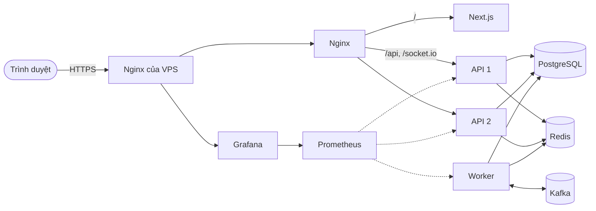
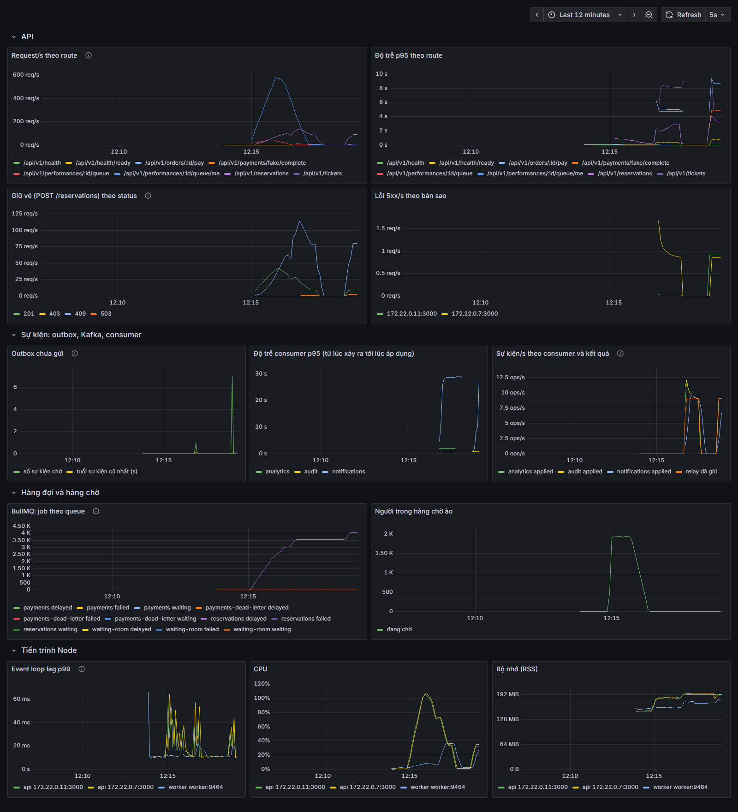

# Questa Booking

[English](README.md) | **Tiếng Việt** &nbsp; [](https://github.com/mquanggdev/questa-booking/actions/workflows/ci.yml)

Backend bán vé concert chịu được lúc hàng nghìn người cùng tranh một số ghế: không ghế nào bán hai lần, không mất khoản thanh toán nào, và có load test để chứng minh.

**Bản demo:** <https://booking.quangtm.site> · [Swagger](https://booking.quangtm.site/api/docs) · [Grafana](https://grafana.quangtm.site) (chỉ xem)

- Đăng ký tài khoản bất kỳ để mua vé. Thanh toán qua cổng giả lập, không mất tiền thật.
- Góc nhìn ban tổ chức: `demo@questa.test` / `demo-f175ef55`. Chỉ xem được: mọi thao tác ghi đều trả `403`.


## Vì sao khó

Một đợt mở bán là vài phút tải dồn dập, khi ai cũng muốn cùng mấy ghế đẹp. Cách viết dễ nghĩ nhất (đọc ghế, thấy trống, ghi đơn) sẽ bán một ghế cho hai người ngay khi các request chồng lên nhau. Mình bắt đầu từ đúng phiên bản đó, đo xem nó hỏng tới mức nào, rồi sửa từng phần và đo lại.

## Kiến trúc



- **PostgreSQL** là nguồn dữ liệu duy nhất đáng tin. Mọi lượt bán được quyết định ở đây.
- **Redis** đứng phía trước làm bộ lọc nhanh, giữ vé có thời hạn, chạy hàng chờ ảo, rate limit, cache và adapter của Socket.IO. Redis có sập thì database vẫn giữ mọi thứ đúng.
- **Worker** chạy job BullMQ (nhả vé hết hạn, hoàn tiền, cho người vào từ hàng chờ) và chuyển sự kiện từ bảng outbox sang Kafka.
- **Kafka** đưa sự kiện đơn hàng tới ba consumer: email vé, thống kê bán vé, nhật ký audit.

Công nghệ: NestJS · PostgreSQL · Prisma · Redis · BullMQ · Kafka · Socket.IO · Next.js · k6 · Docker Compose · GitHub Actions · Prometheus · Grafana.

## Các quyết định chính

Lý do đầy đủ và các phương án đã loại nằm trong [`docs/adr/`](docs/adr/).

- **Khóa ngay trong database.** Giữ ghế bằng một câu `UPDATE ... WHERE status = 'AVAILABLE'`; khu vé đứng dùng bộ đếm được chặn theo cùng cách; unique index bắt nốt phần còn lại. `SERIALIZABLE` cũng đúng, nhưng phải thử lại quá nhiều khi tranh chấp cao. ([0008](docs/adr/0008-seat-and-standing-locking.md))
- **Idempotency key lưu cùng đơn hàng**, trong cùng transaction, nên bấm hai lần hay gửi lại đều nhận về đúng đơn cũ. ([0009](docs/adr/0009-idempotency-and-ticket-limit.md))
- **Redis lọc, không quyết định.** Nó chặn phần lớn request chắc chắn thua trước khi chạm database. Redis lỗi thì request đi thẳng vào PostgreSQL thay vì bị từ chối. ([0010](docs/adr/0010-redis-gate-and-expiry.md))
- **Quá tải thì trả `503 Retry-After`** thay vì để request xếp hàng đến khi timeout. ([0007](docs/adr/0007-load-testing-and-overload.md))
- **Thanh toán chỉ được xác nhận bằng IPN có chữ ký** từ cổng thanh toán, không bao giờ dựa vào trang chuyển hướng. Tiền về cho đơn đã hết hạn được hoàn tự động. ([0012](docs/adr/0012-payments-ipn-and-refunds.md))
- **Outbox trong transaction cho sự kiện.** Sự kiện được ghi cùng transaction với thay đổi của đơn; relay đẩy nó lên Kafka; consumer chống trùng trong cùng transaction với phần ghi của mình. Gửi thẳng lên Kafka sau khi commit thì có thể mất sự kiện. ([0017](docs/adr/0017-outbox-kafka-and-consumers.md))
- **Hàng chờ ảo bằng sorted set của Redis**: script Lua cấp số thứ tự, job BullMQ cho người vào theo tốc độ đã đo trên máy này. ([0016](docs/adr/0016-presale-codes-and-waiting-room.md))

BullMQ lo các việc cần hẹn giờ hoặc thử lại (nhả vé hết hạn, hoàn tiền, cho vào từ hàng chờ). Kafka lo các sự kiện đã xảy ra mà nhiều phần khác cần phản ứng (đơn đã trả tiền, hết hạn, đã hoàn tiền).

## Benchmark

k6 chạy trong mạng Docker, sau đó SQL kiểm tra kết quả thẳng trong PostgreSQL. Máy đo: Ryzen 5 4600H, 16 GB. Toàn bộ lịch sử: [`docs/benchmarks.md`](docs/benchmarks.md).

| Kịch bản | Trước | Sau |
| --- | --- | --- |
| 5.000 khách, 100 ghế | code ngây thơ: **4–11 ghế bán hai lần** mỗi lần chạy | khóa trong database: **0** ở mọi lần chạy |
| 5.000 khách, 500 vé đứng | phát **925 vé** cho 500 chỗ | đúng **500** |
| Cùng kịch bản tranh ghế, tắt → bật bộ lọc Redis | 159–211 req/s, p50 ~5 s | **701–815 req/s**, p50 11–456 ms |
| 1 → 2 instance API | 525 req/s | **790 req/s**; giết một instance giữa chừng không hỏng gì |
| Đọc danh mục 400 req/s, tắt → bật cache | p95 4,9 s | p95 **7 ms** |
| Mở bán: 4.000 khách, 10.000 vé | không hàng chờ: p95 **10,7 s**, 16% lỗi | có hàng chờ: p95 **99–272 ms**, 0 lỗi, không ai lách được hàng |
| IPN hỗn loạn: gửi trùng, chữ ký giả, tiền về muộn | — | **0** lần trừ tiền hai lần hay mất thanh toán; 500 đơn đã trả, 250 đơn hoàn tiền |
| Sự kiện đơn hàng qua Kafka, giết worker giữa chừng | — | mỗi sự kiện được cả 3 consumer áp dụng **đúng một lần** |

Trên laptop này, cùng một kịch bản có thể chênh nhau vài lần giữa các lần chạy, nên các phép so sánh trước và sau luôn được chạy liền nhau.



## Chạy thử

Cần Docker, Node.js 24 và pnpm.

```bash
cp .env.example .env
docker compose up -d --build
pnpm install
pnpm --filter @questa/api db:seed
```

- Web: <http://localhost:3200>
- Swagger: <http://localhost:3000/api/docs>
- Mailpit (email vé): <http://localhost:8025>
- Grafana: `docker compose --profile monitoring up -d`, rồi mở <http://localhost:3300>

Tài khoản mẫu dùng mật khẩu trong `SEED_PASSWORD`: `organizer@questa.test`, `customer0001@questa.test` … `customer5000@questa.test`. Muốn thanh toán qua VNPay sandbox thật, xem [`docs/vnpay-sandbox.md`](docs/vnpay-sandbox.md).

```bash
pnpm test                 # unit test
pnpm test:e2e             # e2e test (cần stack đang chạy)
pnpm loadtest contention  # hoặc: standing, browse, full-flow, webhook-chaos, check-in, on-sale
```

Deploy chạy từ GitHub Actions khi đẩy tag phiên bản: build image, đẩy lên GHCR, SSH vào VPS, khởi động bản mới và quay về bản cũ nếu không khỏe. Cài đặt server: [`docs/deploy-vps.md`](docs/deploy-vps.md).

## Giới hạn

- Toàn bộ chạy trên một VPS, PostgreSQL, Redis và Kafka mỗi thứ một node. Đủ cho demo, chưa đủ cho độ sẵn sàng thật.
- Consumer gửi email vé là phần chậm nhất lúc cao điểm (trễ khoảng 28 s ở p95), vì nó sinh mã QR và gửi mail lần lượt từng sự kiện.
- Bản demo dùng cổng thanh toán giả lập. Email nằm lại trong Mailpit trên server, không gửi đi thật.
- Chưa có giao diện quản trị: ban tổ chức tạo concert và đợt mở bán qua API.

## Giấy phép

[MIT](LICENSE)
